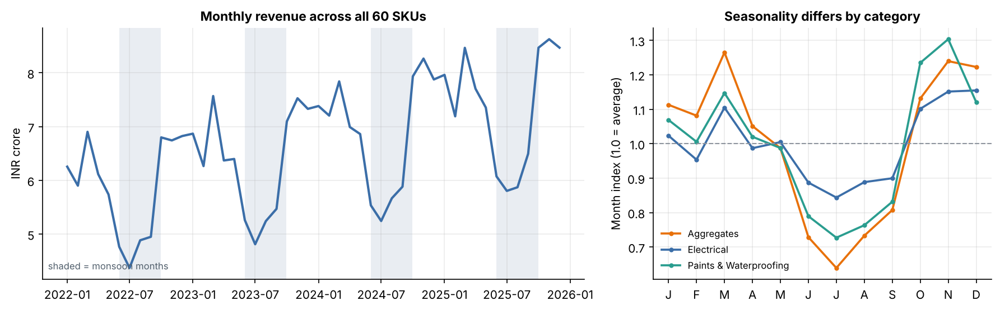
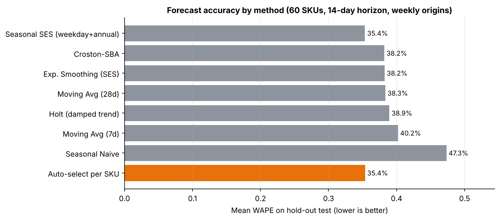
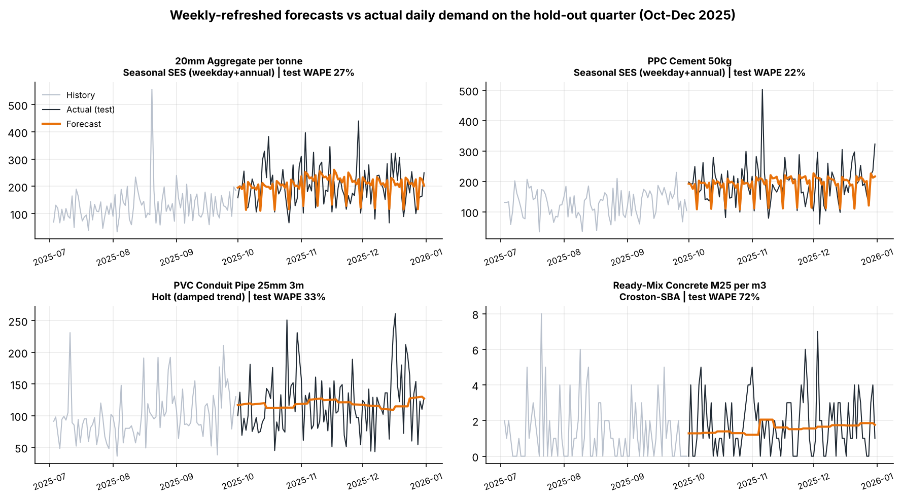
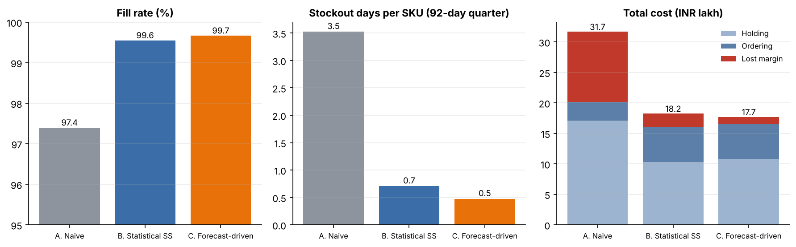
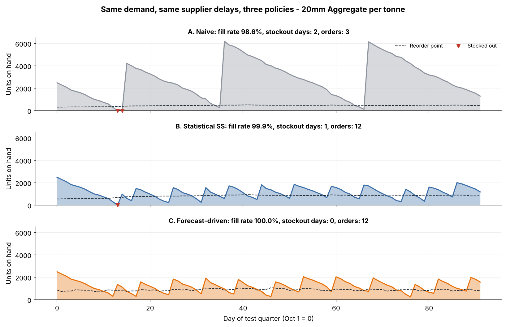
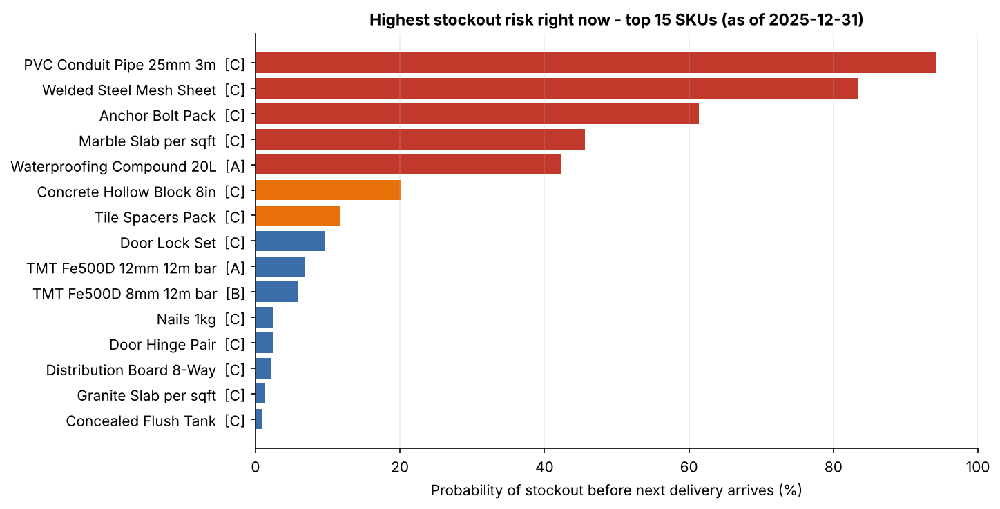
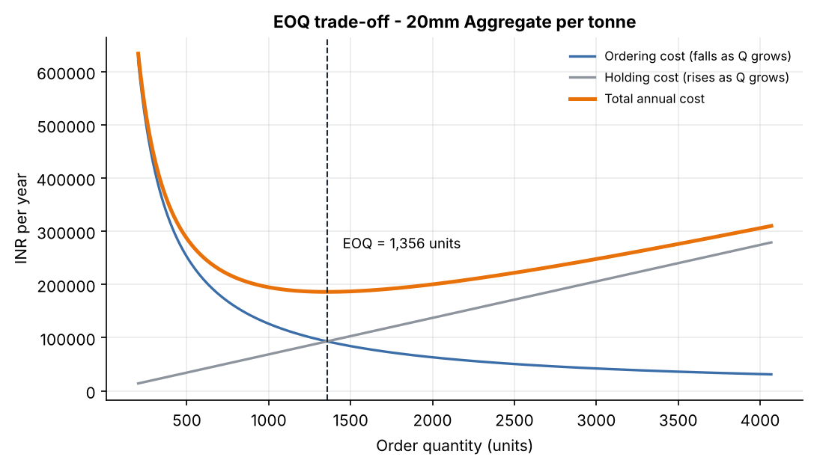

# Inventory Demand Forecasting & Reorder Planning

**Python · Pandas · NumPy · Matplotlib**

An end-to-end replenishment-planning project for a construction-materials distributor: forecast SKU-level demand,
turn the forecast into **EOQ, safety stock and reorder points**, measure **forecast accuracy and stockout risk**, and
test the resulting policy against simpler alternatives in a day-by-day simulation.

> **About the data.** The dataset is **synthetic** (generated by `src/data_generation.py`, fixed seed). It is built to
> behave like a real building-materials business: monsoon slowdown, festive-season peaks, Sunday dips, promotions,
> bulk-order spikes, slow-moving high-ticket items and supplier delays. No real company data is used, so the numbers
> below show that the *method* works on realistic patterns. They are not claims about any real business.

---

## The problem

Order too little and projects stall because a SKU is out of stock. Order too much and cash gets locked up in stock that
sits in a warehouse. For a distributor with hundreds of SKUs and suppliers who deliver late, this comes down to three
questions per SKU:

1. **How much will we sell?** (demand forecast)
2. **When should we reorder?** (reorder point = demand during lead time + safety stock)
3. **How much should we order?** (EOQ: balances ordering cost against holding cost)

## Dataset (`data/`)

| File | Rows | What it contains |
|---|---:|---|
| `sales_history.csv` | 87,660 | Daily units, price, revenue and promo flag for **60 SKUs × 1,461 days** (Jan 2022 – Dec 2025) |
| `sku_master.csv` | 60 | Category, unit cost & price, cost per purchase order, annual holding-cost rate, supplier lead time |
| `lead_time_history.csv` | 2,696 | Realised supplier lead times for past purchase orders (used to measure lead-time variability) |
| `inventory_snapshot.csv` | 60 | Stock on hand / on order on the last day, so the plan can say "reorder now?" |

60 SKUs across 9 categories: cement, steel, bricks, aggregates, tiles, plumbing, electrical, paints, hardware.



## Method

```
sales_history ─► rolling-origin backtest ─► best model per SKU ─► reorder plan (EOQ / SS / ROP / risk)
                  (7 methods, tuned on                                     │
                   validation, scored on                                   ▼
                   untouched test quarter)               day-by-day policy simulation vs 2 baselines
```

**Time-based split (no leakage):** train Jan 2022 – Jun 2025 → validation Jul–Sep 2025 (choose method and smoothing
parameters per SKU) → **hold-out test Oct–Dec 2025** (never used for any choice).

**Forecasting methods**, all implemented in NumPy in `src/forecasting.py`:

| Method | Idea |
|---|---|
| Seasonal Naive | repeat the last 7 days (benchmark) |
| Moving Average (7d, 28d) | flat forecast = recent mean |
| Simple Exponential Smoothing | recent days weigh more, `alpha` tuned per SKU |
| Holt (damped trend) | smoothing plus a trend that fades out |
| Croston-SBA | built for intermittent demand (slow movers) |
| **Seasonal SES** | removes weekday and monsoon/annual seasonality, smooths the level, then puts the seasonality back |

Forecasts are **re-issued every week** (rolling origin), the way a planner would re-plan, and scored over a 14-day
horizon with **WAPE** (robust to zero-demand days, unlike MAPE) and **bias** (positive = over-forecasting).

**Inventory maths** (`src/inventory.py`):

- `EOQ = √(2·D·S / H)` using forecast annual demand `D`, order cost `S`, and holding cost `H = unit cost × holding rate`
- `Safety stock = z · √(σ_LTD² + (d·σ_L)²)`, which covers both **forecast error over the lead time** (`σ_LTD`) and **supplier lead-time variability** (`σ_L`)
- `Reorder point = d · L + safety stock`
- `Stockout risk = P(demand during lead time > stock on hand + on order)`
- **ABC classes** by revenue set the target service level: A = 98%, B = 95%, C = 90%

## Results

### 1. Forecast accuracy (hold-out Oct–Dec 2025, 60 SKUs)

| Method | WAPE ↓ | Bias |
|---|---:|---:|
| **Auto-select best method per SKU** | **35.4%** | +0.6% |
| Seasonal SES (weekday + annual) | 35.4% | +1.1% |
| Exp. Smoothing (SES) | 38.2% | −5.4% |
| Moving Avg (28d) | 38.3% | −4.4% |
| Croston-SBA | 38.2% | −8.8% |
| Holt (damped trend) | 39.0% | −1.1% |
| Moving Avg (7d) | 40.2% | −1.9% |
| Seasonal Naive | 47.3% | −1.8% |

Daily SKU-level demand is noisy, so an error around 35% is expected. What matters is that modelling seasonality
cuts error by about 8% relative to the best non-seasonal method (28-day average) and by about 25% relative to the
seasonal-naive benchmark. The non-seasonal methods also **under-forecast** (negative bias) because they lag the
Oct–Dec ramp-up after the monsoon, and under-forecasting is what causes stockouts. Validation selected Seasonal SES
for 55 of 60 SKUs, Croston for 3 slow movers and Holt for 2.




### 2. Replenishment policy simulation (test quarter, 30 Monte-Carlo runs over random supplier lead times)

Three reorder-point policies replayed against the **actual** demand of Oct–Dec 2025. Stock-outs are lost sales, and every
policy sees identical lead-time draws.

| | A. Naive (no safety stock) | B. Statistical safety stock | **C. Forecast-driven (this project)** |
|---|---:|---:|---:|
| Fill rate | 97.4% | 99.6% | **99.7%** |
| Stockout days per SKU (of 92) | 3.5 | 0.7 | **0.5** |
| Average inventory value | ₹3.43 cr | **₹2.09 cr** | ₹2.19 cr |
| Total cost (holding + ordering + lost margin) | ₹31.7 lakh | ₹18.2 lakh | **₹17.7 lakh** |

- **A → C:** stockout days fall by 87% and total cost by 44%, with a third less capital tied up in stock.
- **B → C (the fairer comparison):** forecasting adds a smaller gain, about 33% fewer stockout days and 3% lower total
  cost, for roughly 5% more inventory. The textbook safety-stock policy is already a strong baseline, and the forecast
  model buys extra protection at a modest holding cost. On this synthetic data, most of the value comes from holding the
  *right* safety stock (A → B), and better forecasts refine it further (B → C).
- The fill rates (≈99.6%) sit above the 90–98% targets because those targets are *cycle service levels* (the chance of
  no stockout per replenishment cycle), which are stricter than fill rate (the share of units delivered).




### 3. Reorder plan and stockout risk as of 31 Dec 2025 (`outputs/tables/reorder_plan.csv`)

One row per SKU: forecast daily demand, lead-time stats, service level, **safety stock, reorder point, EOQ**, current
stock, days of cover, **stockout probability**, a Low/Medium/High risk band, and a *reorder now / suggested order
quantity* flag. On the snapshot data, **9 of 60 SKUs are at or below their reorder point** and **5 are high risk**
(for example PVC conduit pipe, welded steel mesh, anchor bolts).




## Run it

```bash
git clone <your-repo-url> && cd inventory-demand-forecasting
pip install -r requirements.txt

python main.py                # full pipeline, about 20 seconds
python main.py --regenerate   # rebuild the synthetic dataset first
python -m pytest -q           # 20 unit tests (formulas, forecasters, metrics, data generation)
```

Outputs are written to `outputs/tables/` (CSVs) and `outputs/figures/` (PNGs).

## Project structure

```
├── main.py                  # runs the whole pipeline
├── data/                    # generated CSVs (sales, SKU master, lead times, stock snapshot)
├── src/
│   ├── config.py            # date windows, horizons, service levels
│   ├── data_generation.py   # synthetic dataset
│   ├── forecasting.py       # 7 forecasting methods + WAPE / bias / MAE / RMSE
│   ├── backtest.py          # rolling-origin backtest, per-SKU tuning and model selection
│   ├── inventory.py         # EOQ, safety stock, reorder point, ABC, stockout probability
│   ├── planning.py          # forward-looking reorder plan
│   ├── simulation.py        # day-by-day policy simulation (3 policies, Monte-Carlo)
│   └── plots.py             # Matplotlib charts
├── tests/test_core.py
└── outputs/{tables,figures}
```

## Limitations and assumptions

- **Synthetic data.** Real data adds stockout censoring (sales are not demand when stock is out), returns, price
  changes and one-off project orders.
- **Normality.** Safety stock assumes lead-time demand is roughly normal; this is weaker for very lumpy slow movers.
- **Lost sales, single echelon, one supplier per SKU, no MOQ or storage limits.** The cost weights (margin as the
  stockout penalty, holding rate by category) are assumptions and would be replaced with the company's own figures.
- **Seasonality needs history.** The annual index uses complete past years, so new SKUs would fall back to the
  non-seasonal methods.
- The simulation replays a single quarter. A longer or rolling simulation would give tighter confidence on the small B → C difference.

## Possible extensions

Gradient-boosted models with promo and price features · probabilistic (quantile) forecasts feeding safety stock
directly · multi-supplier sourcing · demand-sensing from project-pipeline data · a Streamlit dashboard on top of
`reorder_plan.csv`.
